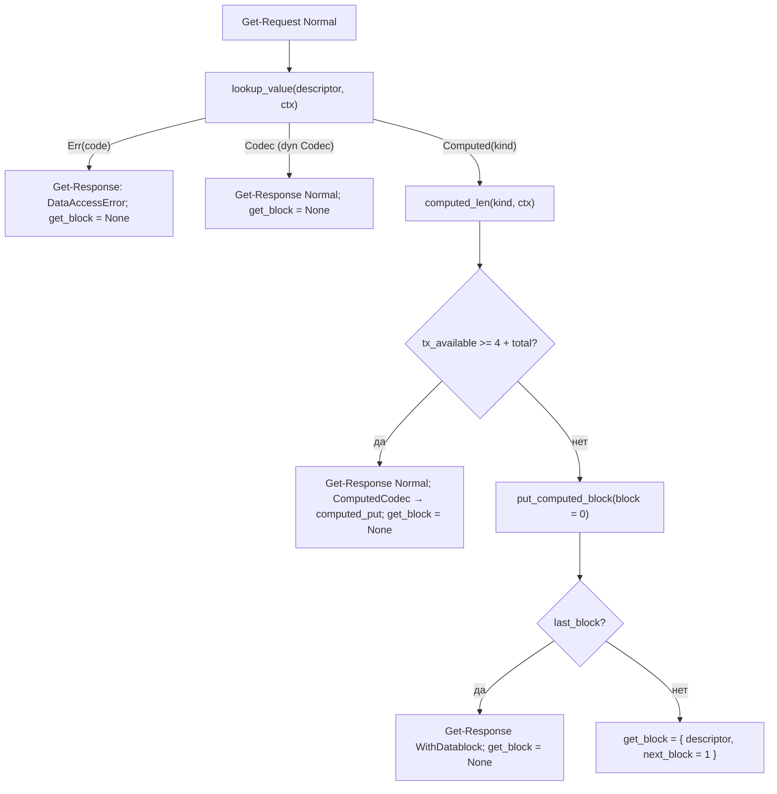
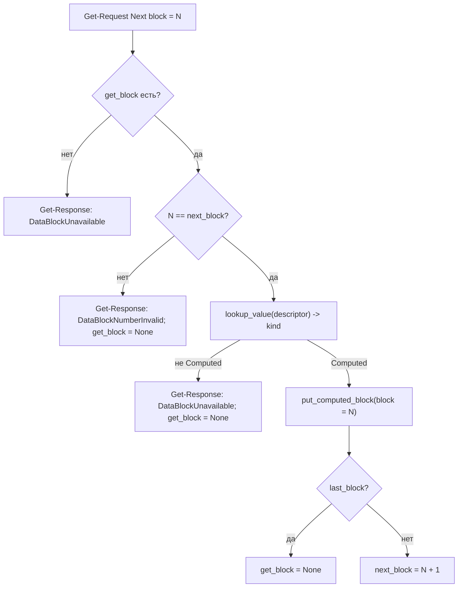
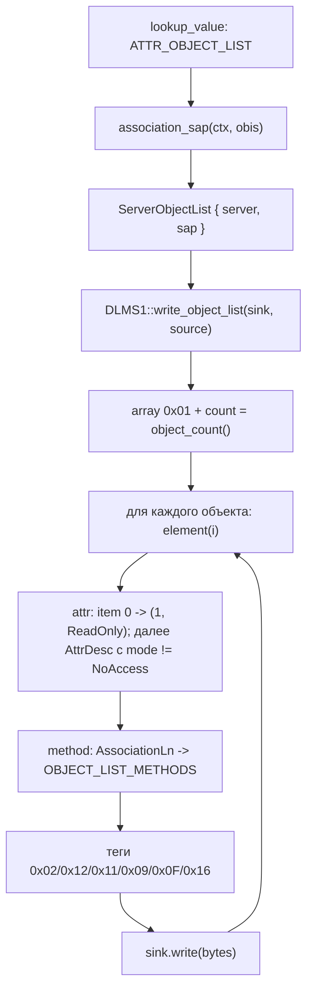

# GBT и формирование `object_list`

> Рабочий документ. Описывает реализованные в `server` механизмы:
> блочную передачу вычисляемых значений (`get-response-with-datablock`)
> и формирование Association LN `object_list` (attr 2) потоковым энкодером.
> Относится к `server/src/lib.rs`, `server/src/session.rs`,
> `cosempdu/src/apdu.rs` и `DLMS1/src/ic/association_ln.rs`.

## 1. Термины и точки в коде

| Термин | Где | Смысл |
|---|---|---|
| `ComputedKind` | `server/src/lib.rs` | «что вычислить» для `RomKind::Computed` (значение не хранится) |
| `GetValue` | `server/src/lib.rs` | результат `lookup_value`: `Codec(&dyn Codec)` или `Computed(kind)` |
| `ComputedCodec` | `server/src/lib.rs` | `Codec`-адаптер для обычного `Get-Response` |
| `handle_get` / `handle_get_next` | `server/src/lib.rs` | обработка `Get-Request Normal` / `Next` |
| `put_computed_block` | `server/src/lib.rs` | кодирование одного `DataBlock-G` |
| `block_capacity` / `tx_available` | `server/src/lib.rs` | расчёт размера блока по буферу и `tx_max` |
| `computed_len` / `computed_put_range` | `server/src/lib.rs` | стратегия 1: длина и окно значения |
| `GetBlock` | `server/src/session.rs` | состояние незавершённой блочной передачи в `Settings` |
| `ObjectListSink` / `ObjectListSource` | `DLMS1/src/ic/association_ln.rs` | sink и источник данных потокового энкодера |
| `write_object_list` | `DLMS1/src/ic/association_ln.rs` | A-XDR-формат `object_list` (Association LN v1) |
| `CountingSink`/`BufferSink`/`WindowSink` | `server/src/lib.rs` | реализации `ObjectListSink` (длина / буфер / окно) |
| `DataBlockG`, `GetResponse::put_with_datablock` | `cosempdu/src/apdu.rs` | APDU блочного ответа |
| `ObjectListElement`, `AccessRight`, … | `DLMS1/src/ic/association_ln.rs` | типы/кодирование `object_list` |

### GBT vs. `block-transfer-with-get-or-read`

В `cosempdu` есть оба conformance-бита:

- `GENERAL_BLOCK_TRANSFER` (бит 2) — отдельный GBT APDU;
- `BLOCK_TRANSFER_WITH_GET_OR_READ` (бит 11) — `get-response-with-datablock`
  (используемые `DataBlock-G`, `GetResponse::put_with_datablock`).

`PROPOSED_CONFORMANCE = [0x00, 0x7E, 0x1F]` выставляет бит 11 и **не** выставляет
бит 2, поэтому фактически используется datablock-путь GET.

## 2. `ComputedKind` — вычисляемые атрибуты

```rust
pub enum ComputedKind {
    XdlmsContextInfo,          // текущая ассоциация (согласованные параметры)
    DefaultXdlmsContextInfo,   // чужая ассоциация (серверные значения по умолчанию)
    AssociationStatus,         // из SessionState текущей ассоциации
    DefaultAssociationStatus,  // чужая ассоциация → non-associated
    ObjectList(u8),            // object_list для указанного client_SAP
}
```

Ключевая идея: `Computed` хранит **не значение**, а описание. Значение
пересоздаётся при каждом запросе, поэтому возможны значения произвольного
размера (вплоть до `object_list` на сотни объектов) без heap и без
материализации в стеке.

## 3. Общий поток GET



`lookup_value` выполняет всю проверку доступа (`class_id`, наличие атрибута,
`access.can_read`) и возвращает либо ссылку на сохранённое значение, либо
`ComputedKind`. Ошибка доступа попадает в тело ответа как `DataAccessError`,
а не прерывает обработку.

## 4. Блочная передача (GBT)

### 4.1 Состояние передачи

`Get-Request-Next` не содержит дескриптора атрибута, поэтому дескриптор
запоминается на время передачи:

```rust
pub struct GetBlock {
    pub descriptor: CosemAttributeDescriptor, // что читаем
    pub next_block: u32,                      // ожидаемый номер следующего блока
}

pub struct Settings {
    // ...
    pub get_block: Option<GetBlock>,
}
```

### 4.2 Выбор `Normal` или `datablock`

- `computed_len(kind, ctx)` даёт полную длину A-XDR значения;
- `tx_available(ctx, buf) = min(buf.remaining(), tx_max)` (`tx_max == 0`
  означает «по размеру буфера»);
- если `tx_available >= 4 + total` (`4` = tag + normal + invoke + data-choice) —
  обычный ответ, иначе — блок 0.

### 4.3 Размер блока

Длина payload подбирается так, чтобы блок целиком влез в доступное место:

```
FIXED = 9  // tag + variant + invoke + presence + block-number(4) + choice
avail = min(buf.remaining(), tx_max)
cap:  cap + length_prefix_len(cap) + FIXED <= avail
```

`length_prefix_len` совпадает с кодированием `cosempdu::axdr::put_length`
(1 байт до `0x7F`, далее `0x80 | n` + `n` байт). `block_capacity` решает
неравенство итеративно (сходится за 1–2 шага).

Смещение блока — **stateless**:

```
offset  = block_number * capacity
written = min(capacity, total - offset)
last    = offset + written == total
```

Это «стратегия 1»: значение не хранится между блоками, а пере-кодируется
с начала; берётся окно `[offset, offset + written)`.

### 4.4 Кодирование блока (header «на месте»)

Payload пишется сразу в `tx` без промежуточного scratch:

1. вычислить `header_len = FIXED + length_prefix_len(written)`;
2. `buf.set_pos(start + header_len)` — зарезервировать заголовок;
3. `computed_put_range(kind, ctx, offset, written, buf)` — записать payload;
4. `buf.set_pos(start)` и заполнить заголовок:
   `0xC4` (`GetResponse` tag), `0x02` (`with-datablock`), invoke,
   флаг `last` (`0xFF`/`0x00`), `block_number` (u32 BE), `0x00` (raw-data),
   A-XDR длина, затем payload уже на месте;
5. `buf.set_pos(end)`.

```mermaid
flowchart LR
    A["tx_available = min(remaining, tx_max)"] --> B["capacity: cap + len_prefix(cap) + 9 <= avail"]
    B --> C["offset = block * capacity"]
    C --> D["written = min(capacity, total - offset)"]
    D --> E["header_len = 9 + len_prefix(written)"]
    E --> F["set_pos(start + header_len)"]
    F --> G["computed_put_range(offset, written) -> tx"]
    G --> H["set_pos(start): записать заголовок"]
    H --> I["set_pos(end): готовый DataBlock-G"]
```



### 4.5 Продолжение (`Get-Request-Next`)



`process_get` декодирует `GetRequest::Normal` / `GetRequest::Next` в owned-поля
и выбирает `handle_get` или `handle_get_next`. `WithList` и `access_selection`
пока не поддерживаются.

### 4.6 Ошибки блочного пути

| Условие | Ответ |
|---|---|
| буфер слишком мал (`capacity == 0`) | `DataAccessError::DataBlockUnavailable` |
| `offset >= total` (номер вне диапазона) | `DataAccessError::DataBlockNumberInvalid` |
| `Next` без активного transfer'а | `DataAccessError::DataBlockUnavailable` |
| `Next` с неверным номером | `DataAccessError::DataBlockNumberInvalid` |
| пере-кодирование дало не тот размер окна | `Error::Codec(...)` (внутренняя ошибка) |

## 5. Формирование `object_list`

`object_list` — Association LN attr 2: массив элементов

```
array(1) count
  structure(4)
    class_id: long-unsigned
    version: unsigned
    logical_name: octet-string
    access_rights: structure(2)
      attribute_access: array
        structure(3) { attribute_id: integer, access_mode: enum, access_selectors: null }
      method_access: array
        structure(2) { method_id: integer, access_mode: enum }
```

Важно: длины A-XDR массивов/структур — это **количество элементов/полей**,
а не байты, поэтому список можно кодировать потоково, не зная полной длины
заранее (полная длина нужна только для выбора блока).

### 5.1 Регистрация атрибута

`object_list` зарегистрирован как `AttrKind::Computed` (RO) для четырёх
экземпляров Association LN: public / reader / configurator / base.
После добавления `object_list` и `association_status` таблица
`server::ATTRS` содержит 22 записи (было 14).

### 5.2 client_SAP ассоциации

```rust
fn association_sap(ctx, obis) -> u8 {
    if obis == BASE || Some(obis) == assoc_obis(ctx.assoc_idx) { ctx.client_sap }
    else if obis == PUBLIC_OBIS       { client_sap::PUBLIC }
    else if obis == READER_OBIS       { client_sap::READER }
    else if obis == CONFIGURATOR_OBIS { client_sap::CONFIGURATOR }
    else                              { ctx.client_sap } // fallback
}
```

`object_list` строится для SAP **той** ассоциации, чей OBIS запрошен: base и
текущая используют `ctx.client_sap`, остальные — свой уровень доступа.

### 5.3 Содержимое

- Включаются **все объекты** каталога (`Server::objects`, отсортированы по OBIS).
- Для каждого объекта:
  - **атрибут 1** (`logical_name`) синтезируется всегда с `ReadOnly`
    (в `ATTRS` его нет — реестр начинается с атрибута 2); GET по атрибуту 1
    работает для **любого** объекта каталога: `lookup_value` возвращает
    `ComputedKind::LogicalName(obis)` (octet-string из 6 байт);
  - зарегистрированные атрибуты (2+) берутся из `self.attrs` для этого объекта;
    `access.for_sap(sap)` даёт режим; `NoAccess` — атрибут пропускается;
  - **методы**: для `ClassId::AssociationLn` — `AssociationLn::object_list_methods()`
    (метод 1, `reply_to_HLS_authentication`, `MethodAccessMode::Access`);
    для остальных классов список пуст (общего реестра методов в `Server` пока нет).
- Порядок детерминирован (каталог отсортирован), что необходимо для
  stateless-блочности.

### 5.4 Потоковый энкодер и sink'и

Формат (теги, порядок полей, длины-счётчики) живёт в `DLMS1`:

```rust
// DLMS1/src/ic/association_ln.rs
trait ObjectListSink {
    fn write(&mut self, bytes: &[u8]) -> cosempdu::Result<()>;
}

trait ObjectListSource {
    fn object_count(&self) -> usize;
    fn element(&self, index: usize) -> ObjectListElementInfo; // class_id, version, logical_name
    fn attribute_count(&self, index: usize) -> usize;
    fn attribute(&self, index: usize, item: usize) -> (i8, AttributeAccessMode);
    fn method_count(&self, index: usize) -> usize;
    fn method(&self, index: usize, item: usize) -> (i8, MethodAccessMode);
}

fn write_object_list<S: ObjectListSink, P: ObjectListSource>(sink: &mut S, source: &P) -> Result<()>;
```

Сервер в `server/src/lib.rs` реализует `ObjectListSource` (`ServerObjectList`)
и sink'и `ObjectListSink`:

- `CountingSink` — считает длину (для `computed_len`);
- `BufferSink` — пишет в `ByteBuffer` (обычный ответ);
- `WindowSink` — копирует только окно `[offset, offset + max)` (блок);
  остальные байты «пропускает», но продолжает считать (`seen`).

Один и тот же `DLMS1::write_object_list` используется и для длины, и для окна —
это гарантирует согласованность `total`, `offset` и `last_block`.



### 5.5 Approach B (реализован)

A-XDR-формат элементов пишется **сразу в sink** в
`DLMS1::ic::association_ln::write_object_list`. Сервер только отдаёт данные
через `ObjectListSource` (`ServerObjectList`):

- число объектов и их метаданные (`class_id`, `version`, `logical_name`);
- количество и список доступных атрибутов (attr 1 + зарегистрированные);
- количество и список методов (`AssociationLn::object_list_methods()`).

Поэтому в сервере **нет** массивов item'ов и per-element scratch
(ранее подход A давал `items[32]` = 768 B + `ELEMENT_SCRATCH` = 512 B на стек).
Стек потокового энкодера теперь — десятки байт (sink, `ObjectListElementInfo`,
несколько счётчиков и tuple'ов), без heap и без статических буферов.

Зависимость от версии (Association LN **v1**) сосредоточена в `association_ln.rs`:
теги `0x01/0x02/0x12/0x11/0x09/0x0F/0x16/0x00`, порядок полей и список
методов `OBJECT_LIST_METHODS`.

### 5.6 Размер и блочность

Оценка одного элемента:

```
structure header          2
class_id  (0x12+2)        3
version   (0x11+1)        2
logical_name (0x09+L+6)   8
access_rights:
  structure header        2
  attribute_access array  2 + 7 * n_attrs
  method_access array     2 + 6 * n_methods
```

Для ~300 объектов это порядка **8–12 КБ** → datablock-передача обязательна.
`object_list` проходит тот же путь, что и остальные computed: сначала
`computed_len` (counting-pass), затем либо обычный ответ (если влезает),
либо блоки по стратегии 1.

## 6. Длины значений

| `ComputedKind` | `computed_len` |
|---|---|
| `XdlmsContextInfo` | `19 + dedicated_key_len` (0/16/32) |
| `DefaultXdlmsContextInfo` | `19` |
| `AssociationStatus` / `DefaultAssociationStatus` | `2` |
| `ObjectList` | counting-pass (`CountingSink`) |

Мелкие значения считаются арифметически (без кодирования в scratch);
`object_list` — прогоном энкодера в `CountingSink`.

## 7. Ограничения и TODO

- Нет явной проверки negotiated conformance перед выдачей `datablock`
  (проверять `Conformance::is_block_transfer_with_get_or_read()`; иначе —
  `DataBlockUnavailable`).
- `MAX_ATTR_ITEMS`/`ELEMENT_SCRATCH` больше нет: ограничение на число атрибутов
  объекта снято (потоковый энкодер пишет элементы без промежуточных массивов).
- Реестра методов (`MethodDesc`) нет: список методов Association LN v1
  задан константой `OBJECT_LIST_METHODS` в `DLMS1`.
- Атрибут 1 всегда `ReadOnly`, независимо от прав других атрибутов.
- `Get-Request::WithList` и `access_selection` не поддержаны.
- Чужая ассоциация с нестандартным OBIS использует `ctx.client_sap`
  (можно читать `associated_partners_id`, attr 3).
- `put_computed_block` предполагает стабильный `capacity` между блоками:
  он определяется `tx_max` и размером буфера (в `process_get` одинаковы).

## 8. Тесты

- `server_get_xdlms_context_info_computed` — обычный ответ и foreign/default.
- `server_get_xdlms_context_info_block_transfer` — 20-байтный буфер,
  `xDLMS_context_info` (19 Б) не влезает → сборка блоков.
- `server_get_object_list_transfer` — `object_list` целиком в большом буфере
  и тот же ответ, собранный из 20-байтных блоков (побайтовое равенство).
- `wrapper_tests::*` — сквозные GET/SET/AARQ/RLRQ через транспорт.

## Связанные документы

- [Server](server.md) — модель сервера, `Settings`, `Access`, реестр атрибутов
- [APDU](apdu.md) — `GetResponse`, `DataBlockG`, `GetRequestNext`
- [Data](data.md) — COSEM Data types
- [AXDR](axdr.md) — A-XDR, `put_length`
- [Green Book reference](green_book_reference.md) — ссылки на разделы стандарта
